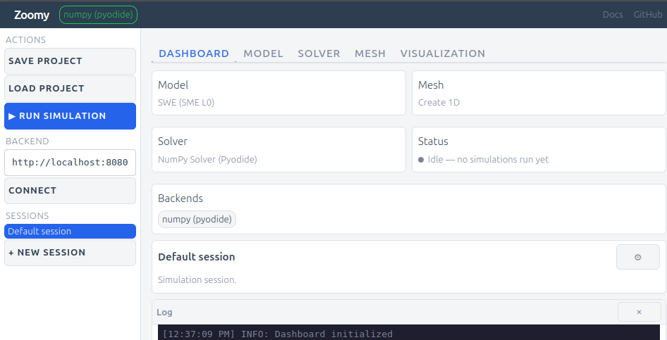

# Using the GUI

::::{grid} 2
:gutter: 3

:::{grid-item-card} Open the GUI
:link: ../gui/index.html
:link-type: url
Launch the Zoomy GUI in your browser.
:::
::::

- **Compose**: pick a Model, Mesh and Solver, optionally a Volume of Fluid participant and Visualization viewers, from cards.
  A parameters panel edits each card, the equations render inline and the mesh previews live.
- **Run in the browser**: the NumPy solver runs on an in-browser Pyodide kernel. No install, no server.
- **Run on a backend**: connect a `zoomy-server` and the composed case is solved there. The result comes back for visualization.
- **It is a case**: every action edits one `case.py` (`## Model`, `## Mesh`, `## Solver settings`, `## Run`).
  It exports as `.py` or `.ipynb`.
- **Output**: `zoomy_core.misc.show.show` renders figures and equations in the GUI and prints plain text in a script.

## Connecting your own backend

A `zoomy-server` on your own machine at `http://localhost:8080` connects without a tunnel or certificate ([Backends](backends.md)).
For another machine, forward the port (`ssh -L 8080:localhost:8080 ...`) or serve it over HTTPS.

How the GUI is built: [developer guide](../developer/gui.md).
