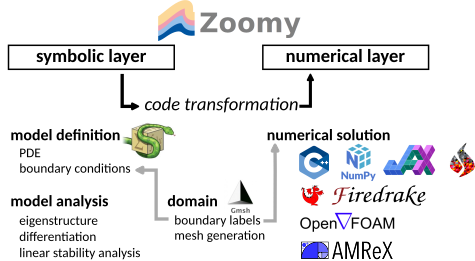
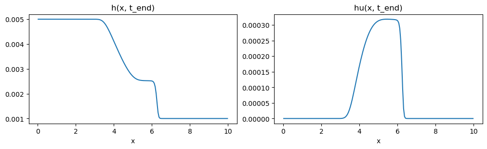
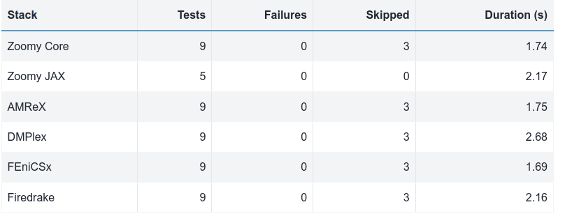

# Zoomy

Zoomy is a flexible modeling and simulation software for free-surface flows.

A model is written once as a symbolic PDE (`Model` -> `SystemModel` ->
`NumericalSystemModel`).  The solvers are templates written once as sympy
graphs and printed for each backend: JAX (CPU, GPU, MPI, automatic
differentiation), OpenFOAM and AMReX (C++, MPI, AMReX on GPUs), with preCICE
coupling.  A cross-backend test matrix checks that every backend passes the
same tests.

Start with the [quick start](guide/quickstart.md), the
[user guide](guide/index.md) or the [test results](testing/symsolver.md).

## Explore Zoomy

::::{grid} 2
:gutter: 3

:::{grid-item-card} Open the GUI
:link: gui/index.html
:link-type: url

Configure simulations, run in the browser, and share via URL. No installation required.
:::

:::{grid-item-card} Run a notebook in your browser
:link: jupyter-lite/_output/lab/index.html?path=pyodide.ipynb
:link-type: url

Walk the full modeling stack — `Model` → `SystemModel` → `NumericalSystemModel` → C++ codegen → NumPy solve — in a Pyodide-powered JupyterLite notebook.
:::

:::{grid-item-card} Play the SWE Game
:link: playground/swe-game/index.html
:link-type: url

Sketch your own irrigation system, open the gate and fill the gardens — a shallow-water-equation game running entirely in your browser.
:::

:::{grid-item-card} Tests and timings
:link: testing/symsolver
:link-type: doc

The cross-backend test matrix and the solver timings, generated from saved results.
:::

::::
